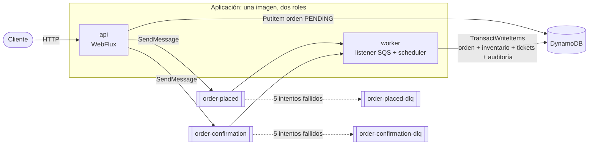
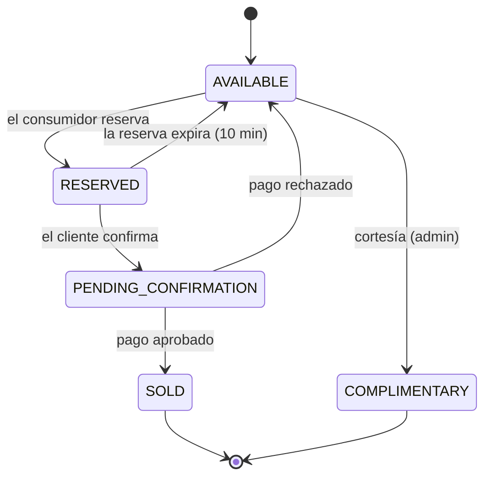
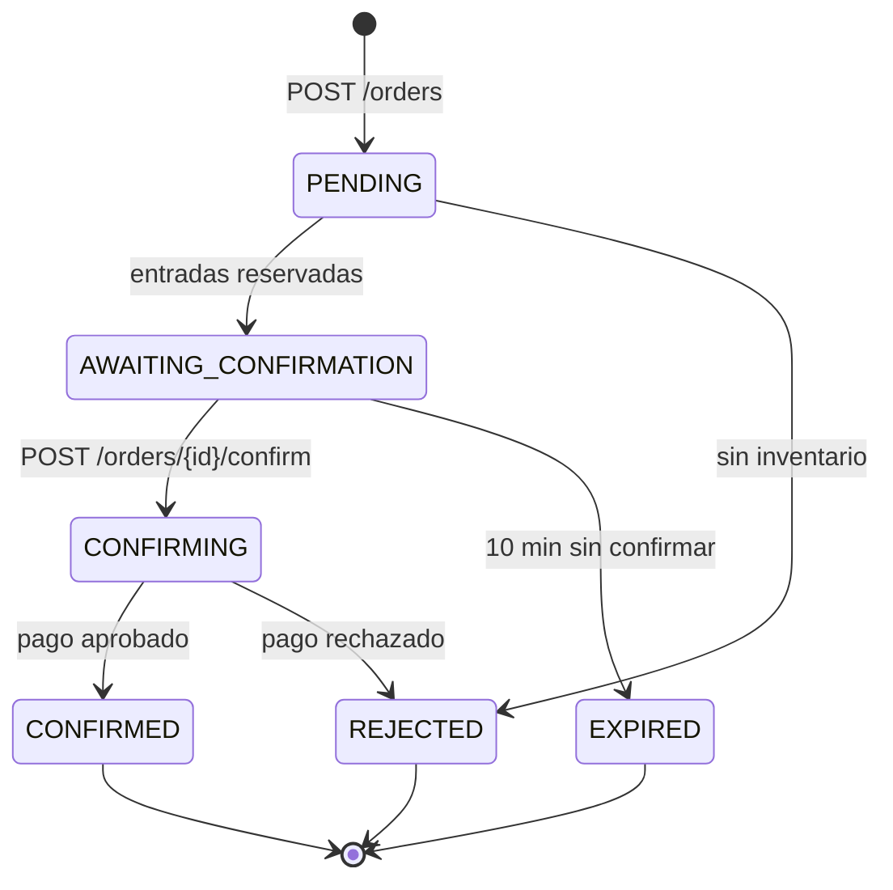
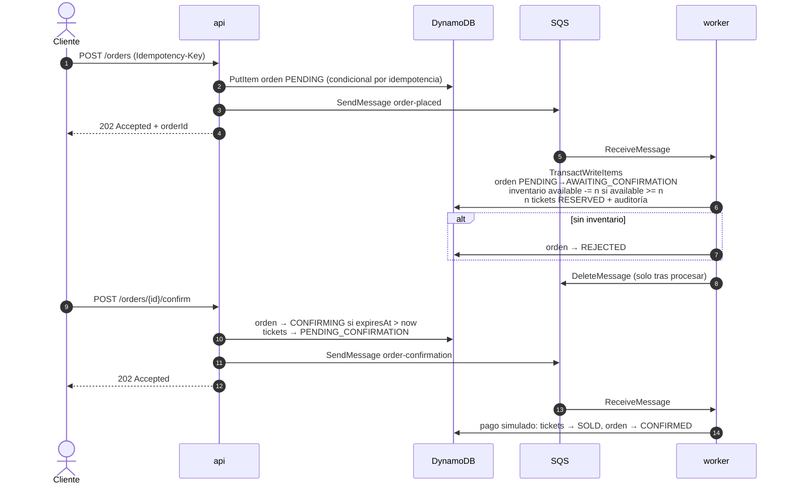
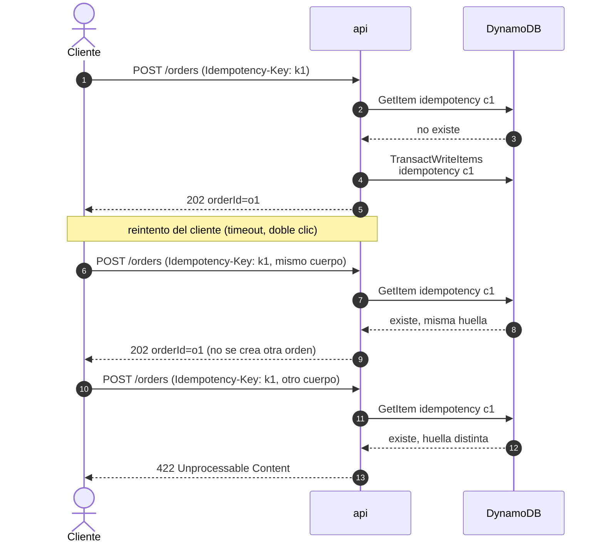
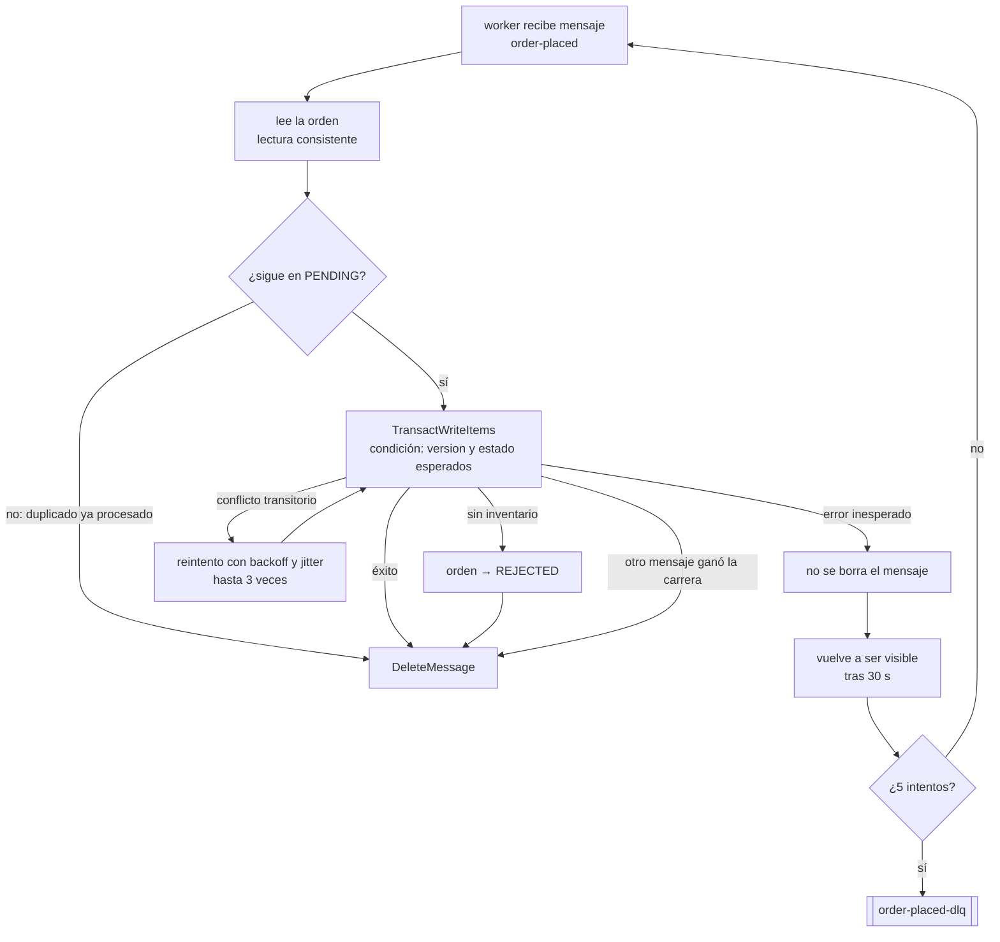

# Ticket Sales Processor

> **Borrador en construcción.** Las secciones marcadas como *(pendiente)* describen lo que falta por implementar.

Backend reactivo y orientado a eventos para la venta de entradas a eventos (conciertos, teatro, deportes) bajo picos de demanda. Resuelve los tres problemas del sistema actual:

| Problema | Cómo se resuelve |
|---|---|
| Sobreventa (asientos vendidos a varias personas) | Escrituras condicionales atómicas en DynamoDB: el inventario solo se descuenta si `available >= quantity`. |
| Compras duplicadas | `Idempotency-Key` en la API y transiciones de estado condicionales en el consumidor (un mensaje repetido no tiene efecto). |
| Timeouts bajo alta concurrencia | La API solo registra la orden, la encola y responde `202 Accepted`; el trabajo pesado lo hace un consumidor asíncrono de SQS. Todo el stack es no bloqueante (WebFlux + AWS SDK v2 asíncrono). |

## Stack

- Java 25 (records, `sealed`, pattern matching con guards y patrones sin nombre)
- Spring Boot 4.1 + Spring WebFlux (API funcional Router/Handler)
- DynamoDB (AWS SDK v2, `DynamoDbEnhancedAsyncClient`)
- SQS (AWS SDK v2, `SqsAsyncClient`) con DLQ
- Clean Architecture generada con [scaffold-clean-architecture](https://github.com/bancolombia/scaffold-clean-architecture) de Bancolombia 5.0.5
- Docker y Docker Compose
- Tests: JUnit 5, Mockito, reactor-test (`StepVerifier`), BlockHound, ArchUnit, JaCoCo y Pitest
- Terraform para la infraestructura en AWS *(pendiente)*

## Arquitectura



**Capas** (módulos Gradle del scaffold):

| Capa | Módulo | Contenido |
|---|---|---|
| Dominio | `domain/model` | Entidades (records), máquinas de estado, errores de negocio y puertos (gateways). Sin dependencias de frameworks. |
| Casos de uso | `domain/usecase` | Orquestación reactiva de los flujos de negocio. *(pendiente)* |
| Infraestructura | `infrastructure/driven-adapters` | DynamoDB y SQS (envío). |
| Infraestructura | `infrastructure/entry-points` | API WebFlux y listener de SQS. |
| Aplicación | `applications/app-service` | Ensamblado, configuración y arranque. |

`./gradlew validateStructure` y los tests de ArchUnit verifican que las dependencias entre capas apunten siempre hacia el dominio.

**Roles api y worker**: es una sola aplicación y una sola imagen, que arranca en el rol `api`, `worker` o `all` según la variable `APP_ROLE`. El rol `api` solo expone HTTP; el `worker` solo consume la cola (y, más adelante, ejecuta los procesos periódicos). En producción permite escalar la API por peticiones y el worker por profundidad de cola, aislar la carga pesada de la latencia HTTP y dar a cada rol su propio IAM role de mínimo privilegio. El rol `all` se usa en desarrollo y en los tests.

## Modelo de estados

El enunciado mezcla estados de entrada y de orden. Se modelan como dos máquinas de estado separadas, porque una orden existe (encolada) antes de que exista ninguna entrada.

### Entrada (`TicketStatus`)



- RESERVED y PENDING_CONFIRMATION ocupan inventario pero no son ventas.
- SOLD es final e irreversible. COMPLIMENTARY es final y no contable.
- Una reserva en PENDING_CONFIRMATION no expira: el pago está en curso.

### Orden (`OrderStatus`)



`GET /orders/{id}` devuelve el estado de la orden y el de sus entradas.

## Flujo de compra



Un proceso periódico (`@Scheduled`) libera las reservas vencidas y reencola las órdenes que se quedaron en PENDING *(pendiente)*.

### Idempotencia: la misma petición dos veces

El cliente envía una `Idempotency-Key` por compra. La clave se guarda por cliente (`customerId#key`) junto con una huella SHA-256 del cuerpo, en la misma transacción que crea la orden.



Si dos peticiones con la misma clave llegan a la vez, ambas ven que no existe, pero la condición `attribute_not_exists` solo deja ganar a una transacción. La perdedora relee el registro y responde con la orden de la ganadora. Pasado el TTL de 24 horas, la clave deja de tener efecto.

### Reintentos y DLQ: el mismo mensaje dos veces

SQS entrega cada mensaje al menos una vez, así que el worker debe tolerar duplicados y fallos.



Que un mensaje acabe en la DLQ no pierde la orden: sigue guardada en PENDING y el proceso periódico de reconciliación la puede reencolar.

## Cómo ejecutarlo

### Requisitos

- Docker con Docker Compose v2
- Java 25, solo para compilar o ejecutar los tests fuera de Docker

### Levantar todo con Docker

```bash
docker compose up -d --build
curl http://localhost:8080/actuator/health
```

| Servicio | Puerto | Descripción |
|---|---|---|
| `api` | 8080 | La aplicación en rol `api`: expone HTTP, guarda y encola órdenes |
| `worker` | — | La misma imagen en rol `worker`: consume la cola y reserva |
| `dynamodb` | 8000 | DynamoDB Local, en memoria |
| `dynamodb-init` | — | Crea las tablas y termina (script idempotente) |
| `elasticmq` | 9324 | Emulador de SQS con las colas y DLQ ya configuradas |
| `elasticmq` | 9325 | Panel de estadísticas de las colas |

Para detenerlo: `docker compose down`.

### Ejecutar los tests

```bash
./gradlew test          # tests de todos los módulos
./gradlew build         # compila, ejecuta los tests y la mutación (Pitest)
./gradlew validateStructure
```

El informe de cobertura de cada módulo queda en `<módulo>/build/reports/jacocoHtml/index.html`.

### Configuración

La aplicación se configura por variables de entorno; los valores por defecto apuntan a los emuladores locales.

| Variable | Por defecto |
|---|---|
| `APP_ROLE` | `all` (`api`, `worker` o `all`) |
| `AWS_REGION` | `us-east-1` |
| `DYNAMODB_TABLE_PREFIX` | `ticketing` |
| `DYNAMODB_ENDPOINT` | `http://localhost:8000` |
| `SQS_ENDPOINT` | `http://localhost:9324` |
| `ORDER_QUEUE_URL` | `http://localhost:9324/000000000000/order-placed` |

En local las credenciales son valores ficticios, porque los emuladores no las validan. En AWS no hay credenciales estáticas: se usan IAM task roles.

## Endpoints

| Método | Ruta | Descripción |
|---|---|---|
| `POST` | `/events` | Crear un evento; responde `201` |
| `GET` | `/events` | Listar eventos |
| `GET` | `/events/{id}` | Consultar un evento con su inventario |
| `GET` | `/events/{id}/availability` | Disponibilidad actual (también en tiempo real con SSE) *(pendiente)* |
| `GET` | `/events/{id}/report` | Conteo por estado; las cortesías no cuentan como venta *(pendiente)* |
| `POST` | `/events/{id}/complimentary` | Asignar cortesías (admin) *(pendiente)* |
| `POST` | `/orders` | Crear una orden; requiere `X-Customer-Id` e `Idempotency-Key`; responde `202` |
| `GET` | `/orders/{id}` | Estado de la orden (`orderStatus`) y de sus entradas (`ticketStatus`) |
| `POST` | `/orders/{id}/confirm` | Confirmar la compra (pago simulado); responde `202` *(pendiente)* |

`X-Customer-Id` sustituye al usuario autenticado; con JWT saldría del token.

Los errores siguen el formato RFC 9457 (`application/problem+json`) y nunca exponen detalles internos:

| Error | HTTP |
|---|---|
| Validación de entrada | 400 |
| Recurso no encontrado | 404 |
| Transición inválida, inventario insuficiente, modificación concurrente | 409 |
| `Idempotency-Key` reutilizada con otro cuerpo | 422 |
| Reserva expirada | 410 |
| Error inesperado | 500 |

Los ejemplos con `curl` y la colección de solicitudes se añaden al terminar todos los endpoints.

## Decisiones arquitectónicas

### Concurrencia sin sobreventa
- **Contador atómico con escritura condicional.** Reservar es `ADD available -n` con la condición `available >= n`, sin campo de versión. Con versión, dos reservas simultáneas fallarían aunque hubiera stock y en un evento popular se dispararían reintentos en cascada.
- **Optimistic locking (`version`) solo en las órdenes.** Los tickets se escriben condicionados a su estado esperado, que cumple el mismo papel.
- **`TransactWriteItems`** actualiza en una sola operación atómica la orden, el inventario, los tickets y la auditoría. Con un máximo de 10 entradas por orden se queda muy por debajo del límite de 100 elementos por transacción.
- **Unit of Work en el dominio.** Cada transición se describe como un `StateChange` (orden antes y después, movimiento de inventario, tickets). El puerto `StateChangeRepository` lo aplica todo o nada, y la auditoría se deriva del propio cambio. Cuando DynamoDB cancela la transacción, el adaptador traduce qué condición falló al error de negocio correspondiente: inventario insuficiente o modificación concurrente.
- **Cliente de bajo nivel.** Se usa `DynamoDbAsyncClient` directamente en lugar del Enhanced Client, porque este no permite expresar un `ADD` atómico con condición dentro de una transacción.
- **Reintentos solo de lo transitorio.** Los conflictos entre transacciones (`TransactionConflict`) se reintentan con backoff exponencial y jitter; el SDK no los reintenta por sí solo. Un fallo de condición de negocio nunca se reintenta.
- **Probado con concurrencia real.** Un test lanza 200 compras en paralelo sobre 50 entradas, con cada mensaje entregado tres veces. El resultado es siempre exactamente 50 reservas y ninguna sobreventa.
- **Carrera entre confirmar y expirar.** Confirmar exige `expiresAt > now`; expirar exige `expiresAt <= now`. Solo una de las dos puede ganar, y el dominio lo cubre con un test.

### Mensajería
- **Entrega al menos una vez.** El mensaje se borra solo después de procesarlo. Tras 5 intentos fallidos va a la DLQ.
- **Consumidor idempotente.** Toda transición es condicional al estado actual de la orden, así que un mensaje duplicado no tiene efecto y no hace falta una tabla de deduplicación.
- **Doble escritura (DynamoDB + SQS).** Si el envío a SQS falla después de guardar la orden, esta queda en PENDING y el proceso periódico la reencola. En producción se usaría el patrón outbox.

### Expiración de reservas
- Un barrido periódico consulta un índice secundario (`orderStatus` + `statusChangedAt`), nunca hace un `Scan`.
- No depende del TTL de DynamoDB, que puede tardar horas en borrar un elemento.

### Modelo de datos
Se usan varias tablas (`ticketing-events`, `-orders`, `-tickets`, `-audit` e `-idempotency`) en lugar de una sola: es más fácil de explicar y mantener, y `TransactWriteItems` funciona igual entre tablas. La auditoría es de solo inserción y se escribe en la misma transacción que el cambio de estado, así que ninguna transición queda sin registrar.

### Dominio con Java 25
- Las entidades son `record` inmutables; cada transición devuelve una instancia nueva.
- `OrderTransition` es una `sealed interface` y `Order.apply` la resuelve con un `switch` con guards (`when`) y sin `default`: añadir una transición nueva rompe la compilación hasta que se maneja.
- `DomainException` también es `sealed`, para mapear cada error de negocio a su respuesta HTTP con un `switch` exhaustivo.

### Sin virtual threads
WebFlux ya es no bloqueante: unos pocos hilos atienden miles de peticiones concurrentes. Los virtual threads resuelven el problema del código bloqueante, que aquí no existe. BlockHound, activo en los tests, falla si algún flujo bloquea. Solo hay una excepción declarada: `UUID.randomUUID()`, que lee `/dev/urandom` a través de un `SecureRandom` con buffer y en la práctica no bloquea. Los identificadores se mantienen criptográficamente aleatorios porque aparecen en las URLs.

### Emuladores locales en lugar de LocalStack
Desde la versión 2026.03.0, la imagen de LocalStack exige un token de autenticación. Para que `docker compose up` funcione en cualquier máquina sin cuentas ni secretos, se usan DynamoDB Local y ElasticMQ, compatible con la API de SQS (colas, DLQ, visibility timeout y long polling).

## Seguridad *(parcialmente pendiente)*
- Sin credenciales en el repositorio; la configuración entra por variables de entorno.
- El contenedor se ejecuta con un usuario sin privilegios.
- Idempotencia frente a reintentos maliciosos o del cliente: la misma `Idempotency-Key` con un cuerpo distinto responde `422`. Las claves se guardan por cliente, así que nadie puede colisionar con las de otro ni sondearlas.
- Validación de entrada y máximo de 10 entradas por orden.
- Rate limiting en la API para limitar el abuso de recursos.

## Despliegue en AWS *(pendiente)*
Infraestructura en Terraform, validada con `terraform validate` y `tflint`, sin desplegar: ECS Fargate (servicios api y worker), DynamoDB on-demand con PITR, SQS con DLQ, KMS, IAM de mínimo privilegio, VPC endpoints y CloudWatch.

## Limitaciones y mejoras *(pendiente)*
- Partición caliente en eventos muy populares; se mitigaría con contadores fragmentados (sharded counters).
- Patrón outbox para eliminar la doble escritura.
- Autenticación con JWT.
- Trazas distribuidas (OpenTelemetry o X-Ray) a través de SQS.
