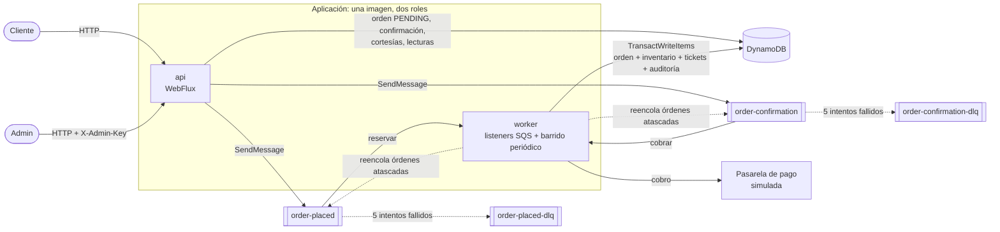
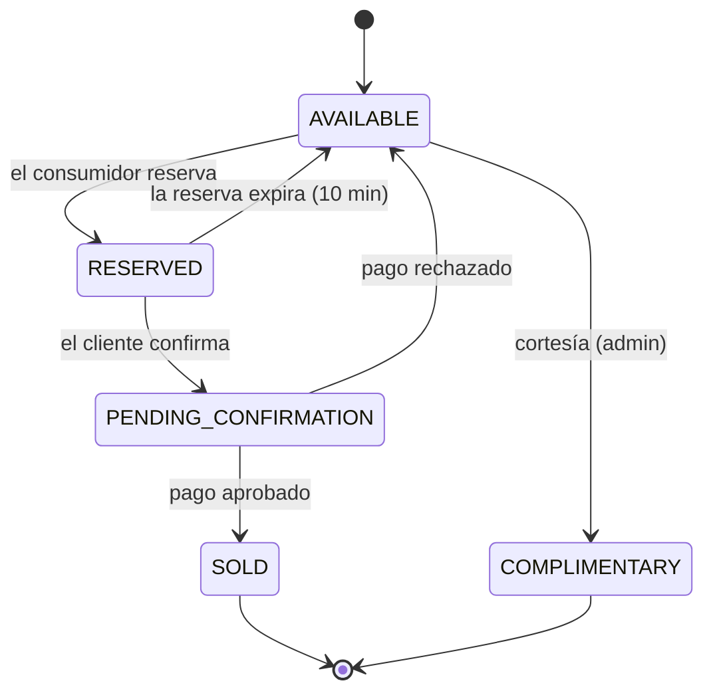
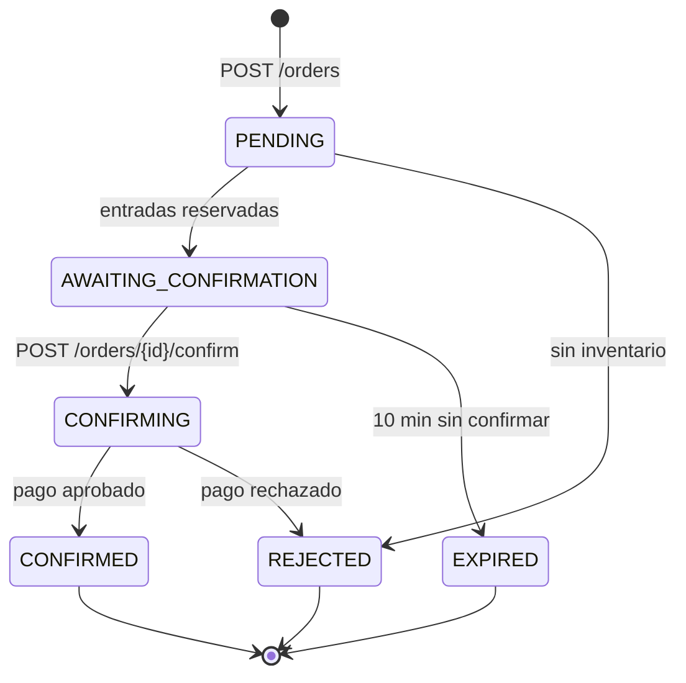
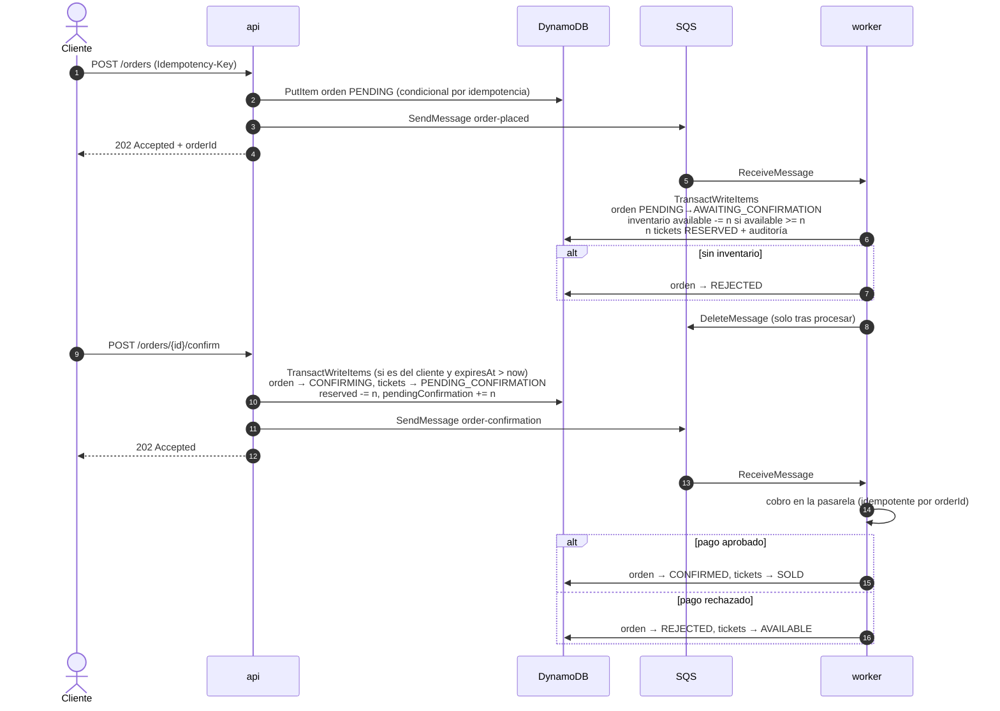
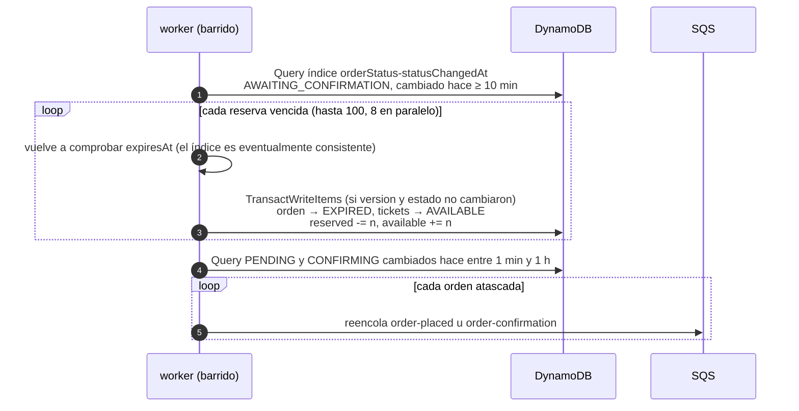
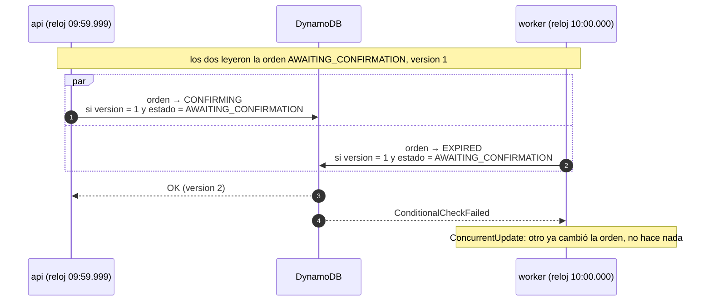
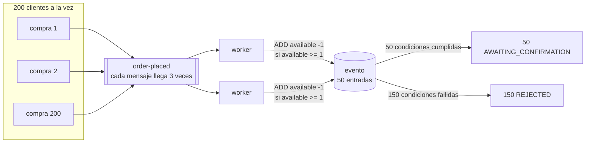
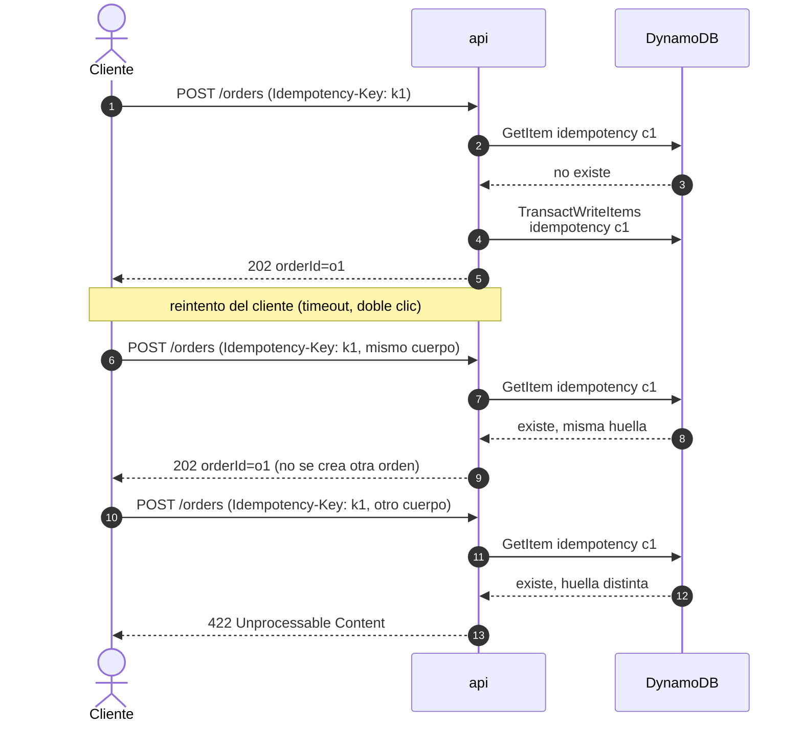
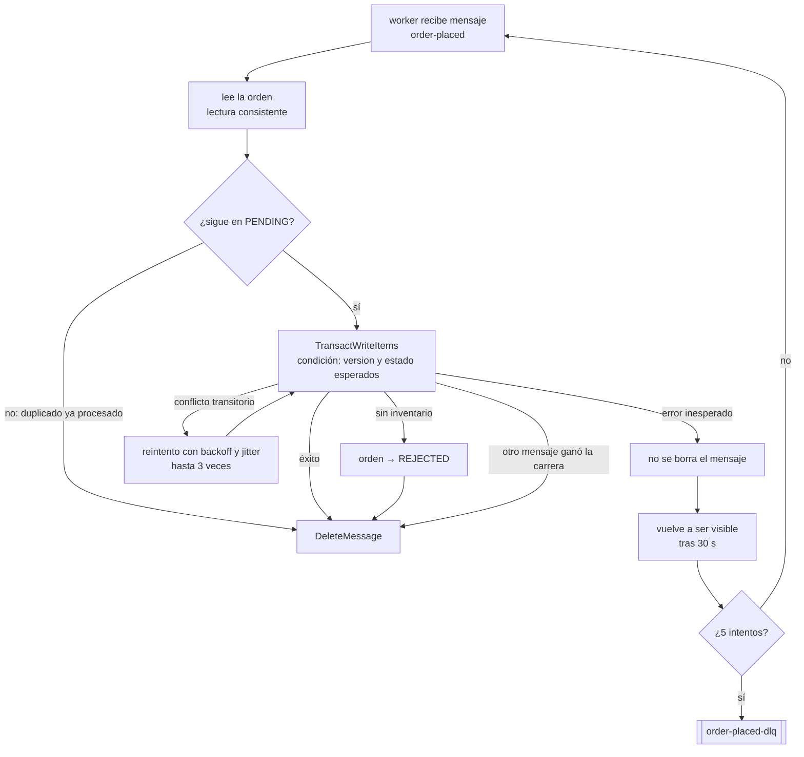
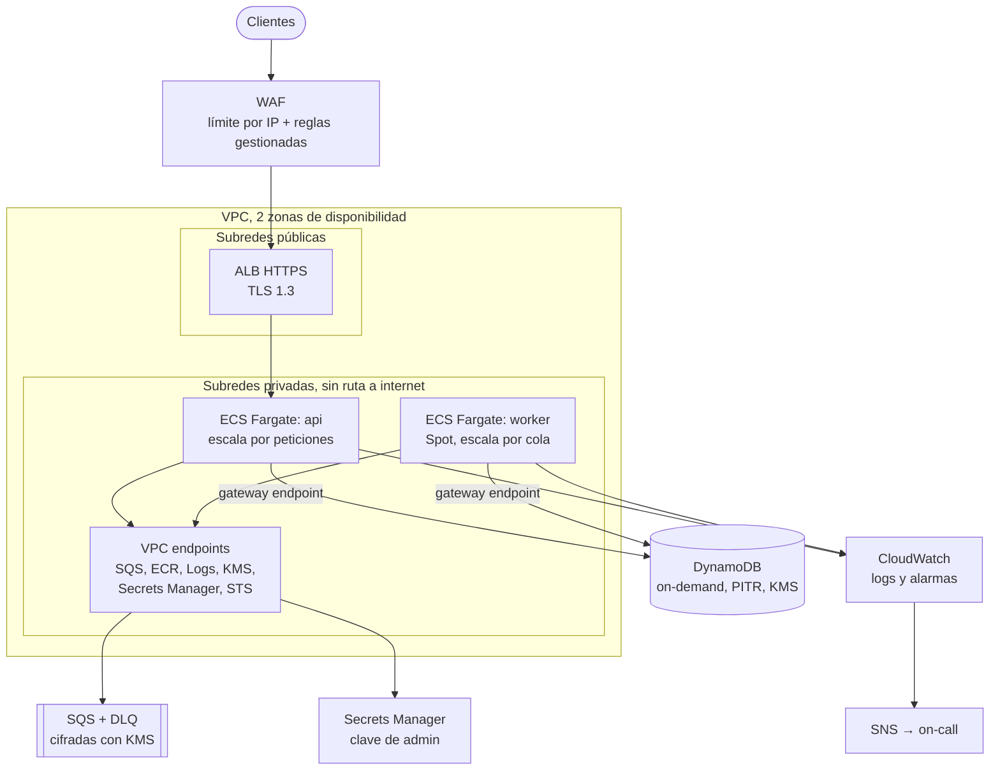

# Ticket Sales Processor

> **Borrador en construcción.** Las secciones marcadas como *(pendiente)* describen lo que falta por implementar.

Backend reactivo y orientado a eventos para la venta de entradas a eventos (conciertos, teatro, deportes) bajo picos de demanda. Resuelve los tres problemas del sistema actual:

| Problema | Cómo se resuelve |
|---|---|
| Sobreventa (asientos vendidos a varias personas) | Escrituras condicionales atómicas en DynamoDB: el inventario solo se descuenta si `available >= quantity`. |
| Compras duplicadas | `Idempotency-Key` en la API y transiciones de estado condicionales en el consumidor (un mensaje repetido no tiene efecto). |
| Timeouts bajo alta concurrencia | La API solo registra la orden, la encola y responde `202 Accepted`; el trabajo pesado lo hace un consumidor asíncrono de SQS. Todo el stack es no bloqueante (WebFlux + AWS SDK v2 asíncrono). |

## Stack

- Java 25 (records, `sealed`, pattern matching con guards y patrones sin nombre)
- Spring Boot 4.1 + Spring WebFlux (API funcional Router/Handler)
- DynamoDB (AWS SDK v2, `DynamoDbEnhancedAsyncClient`)
- SQS (AWS SDK v2, `SqsAsyncClient`) con DLQ
- Clean Architecture generada con [scaffold-clean-architecture](https://github.com/bancolombia/scaffold-clean-architecture) de Bancolombia 5.0.5
- Docker y Docker Compose
- Tests: JUnit 5, Mockito, reactor-test (`StepVerifier`), BlockHound, ArchUnit, JaCoCo y Pitest
- Terraform para la infraestructura en AWS (validado, no desplegado)

## Arquitectura



**Capas** (módulos Gradle del scaffold):

| Capa | Módulo | Contenido |
|---|---|---|
| Dominio | `domain/model` | Entidades (records), máquinas de estado, errores de negocio y puertos (gateways). Sin dependencias de frameworks. |
| Casos de uso | `domain/usecase` | Orquestación reactiva: crear y consultar eventos, crear, reservar, confirmar y cobrar órdenes, cortesías y el barrido de expiración. |
| Infraestructura | `infrastructure/driven-adapters` | DynamoDB, SQS (envío) y la pasarela de pago simulada. |
| Infraestructura | `infrastructure/entry-points` | API WebFlux, listeners de SQS y el barrido periódico. |
| Aplicación | `applications/app-service` | Ensamblado, configuración y arranque. |

`./gradlew validateStructure` y los tests de ArchUnit verifican que las dependencias entre capas apunten siempre hacia el dominio.

**Roles api y worker**: es una sola aplicación y una sola imagen, que arranca en el rol `api`, `worker` o `all` según la variable `APP_ROLE`. El rol `api` solo expone HTTP; el `worker` solo consume las colas y ejecuta el barrido periódico. En producción permite escalar la API por peticiones y el worker por profundidad de cola, aislar la carga pesada de la latencia HTTP y dar a cada rol su propio IAM role de mínimo privilegio. El rol `all` se usa en desarrollo y en los tests.

## Modelo de estados

El enunciado mezcla estados de entrada y de orden. Se modelan como dos máquinas de estado separadas, porque una orden existe (encolada) antes de que exista ninguna entrada.

### Entrada (`TicketStatus`)



- RESERVED y PENDING_CONFIRMATION ocupan inventario pero no son ventas.
- SOLD es final e irreversible. COMPLIMENTARY es final y no contable.
- Una reserva en PENDING_CONFIRMATION no expira: el pago está en curso.

### Orden (`OrderStatus`)



`GET /orders/{id}` devuelve el estado de la orden y el de sus entradas.

## Flujo de compra



Confirmar la orden de otro cliente responde `404`, para no revelar que existe. Confirmar dos veces devuelve el estado actual en lugar de fallar.

### Barrido periódico: expiración y reconciliación

El worker ejecuta un barrido cada 30 segundos. Es un `Flux.interval` en lugar de `@Scheduled`: las ejecuciones nunca se solapan, ningún hilo espera I/O, y la suscripción se cancela limpiamente al apagar.



- **Nunca un `Scan`:** el coste crece con las órdenes que coinciden, no con el tamaño de la tabla.
- **Reconciliación:** si el envío a SQS falló después de guardar la orden, la orden se queda en PENDING o CONFIRMING. El barrido la reencola, y como los consumidores son idempotentes un mensaje de más no tiene efecto. Pasada una hora deja de reencolarla, para no repetir eternamente un mensaje que siempre falla; ese caso queda para revisión.
- **Varios workers a la vez:** si dos workers barren la misma orden, la escritura condicional deja pasar solo a uno; el otro recibe `ConcurrentUpdate` y sigue.

### Carrera entre confirmar y expirar

El cliente confirma en el último milisegundo mientras el barrido expira la misma reserva. La API y el worker corren en máquinas distintas con relojes que no coinciden, así que los dos creen tener razón.



El reloj de cada proceso solo decide si *intenta* la transición; quien decide cuál gana es la condición sobre la versión. Un test lanza 40 confirmaciones y un barrido a la vez, con 1 ms de desfase entre relojes, y comprueba que cada orden termina exactamente en un estado y que el inventario cuadra.

### Concurrencia: muchas compras, pocas entradas



No hay locks ni lecturas previas del inventario: DynamoDB evalúa `available >= 1` y descuenta en la misma operación atómica. Los duplicados no cuentan dos veces porque cada transición también exige que la orden siga en PENDING. El test `ConcurrentReservationTest` reproduce exactamente este escenario cinco veces seguidas.

### Idempotencia: la misma petición dos veces

El cliente envía una `Idempotency-Key` por compra. La clave se guarda por cliente (`customerId#key`) junto con una huella SHA-256 del cuerpo, en la misma transacción que crea la orden.



Si dos peticiones con la misma clave llegan a la vez, ambas ven que no existe, pero la condición `attribute_not_exists` solo deja ganar a una transacción. La perdedora relee el registro y responde con la orden de la ganadora. Pasado el TTL de 24 horas, la clave deja de tener efecto.

### Reintentos y DLQ: el mismo mensaje dos veces

SQS entrega cada mensaje al menos una vez, así que el worker debe tolerar duplicados y fallos.



Que un mensaje acabe en la DLQ no pierde la orden: sigue guardada en PENDING y el proceso periódico de reconciliación la puede reencolar.

## Cómo ejecutarlo

### Requisitos

- Docker con Docker Compose v2
- Java 25, solo para compilar o ejecutar los tests fuera de Docker

### Levantar todo con Docker

```bash
docker compose up -d --build
curl http://localhost:8080/actuator/health
```

| Servicio | Puerto | Descripción |
|---|---|---|
| `api` | 8080 | La aplicación en rol `api`: expone HTTP, guarda y encola órdenes |
| `worker` | — | La misma imagen en rol `worker`: consume la cola y reserva |
| `dynamodb` | 8000 | DynamoDB Local, en memoria |
| `dynamodb-init` | — | Crea las tablas y termina (script idempotente) |
| `elasticmq` | 9324 | Emulador de SQS con las colas y DLQ ya configuradas |
| `elasticmq` | 9325 | Panel de estadísticas de las colas |

Para detenerlo: `docker compose down`.

### Ejecutar los tests

```bash
./gradlew test          # tests de todos los módulos
./gradlew build         # compila, ejecuta los tests y la mutación (Pitest)
./gradlew validateStructure
```

`ConcurrentPurchaseIntegrationTest` levanta DynamoDB Local y ElasticMQ con Testcontainers, usando el mismo script de tablas y la misma configuración de colas que docker-compose. Lanza 100 compras HTTP simultáneas sobre 20 entradas y comprueba que se reservan exactamente 20. Si no hay Docker disponible, se omite.

`./gradlew build` falla si la cobertura de líneas de cualquier módulo baja del 90% (se excluyen el arranque, la configuración de Spring y los DTO). El informe de cada módulo queda en `<módulo>/build/reports/jacocoHtml/index.html`.

### Configuración

La aplicación se configura por variables de entorno; los valores por defecto apuntan a los emuladores locales.

| Variable | Por defecto |
|---|---|
| `APP_ROLE` | `all` (`api`, `worker` o `all`) |
| `AWS_REGION` | `us-east-1` |
| `DYNAMODB_TABLE_PREFIX` | `ticketing` |
| `DYNAMODB_ENDPOINT` | `http://localhost:8000` |
| `SQS_ENDPOINT` | `http://localhost:9324` |
| `ORDER_QUEUE_URL` | `http://localhost:9324/000000000000/order-placed` |
| `CONFIRMATION_QUEUE_URL` | `http://localhost:9324/000000000000/order-confirmation` |
| `ADMIN_API_KEY` | vacío: endpoints de administración deshabilitados (docker-compose usa `local-admin-key`) |
| `SWEEPER_INTERVAL` | `30s` |

En local las credenciales son valores ficticios, porque los emuladores no las validan. En AWS no hay credenciales estáticas: se usan IAM task roles.

## Endpoints

| Método | Ruta | Descripción |
|---|---|---|
| `POST` | `/events` | Crear un evento; responde `201` |
| `GET` | `/events` | Listar eventos |
| `GET` | `/events/{id}` | Consultar un evento con su inventario |
| `GET` | `/events/{id}/availability` | Disponibilidad actual: descuenta vendidas y reservadas temporalmente |
| `GET` | `/events/{id}/availability/stream` | La misma disponibilidad en tiempo real (Server-Sent Events): un evento al conectar y otro en cada cambio |
| `GET` | `/events/{id}/report` | Reporte operativo, contable y de inventario; las cortesías no cuentan como venta |
| `POST` | `/events/{id}/complimentary` | Asignar cortesías; requiere `X-Admin-Key`; responde `201` |
| `POST` | `/orders` | Crear una orden; requiere `X-Customer-Id` e `Idempotency-Key`; responde `202` |
| `GET` | `/orders/{id}` | Estado de la orden (`orderStatus`) y de sus entradas (`ticketStatus`); requiere `X-Customer-Id` del dueño |
| `POST` | `/orders/{id}/confirm` | Confirmar la compra; requiere `X-Customer-Id` del dueño; responde `202` y el pago corre en el worker |

`X-Customer-Id` sustituye al usuario autenticado; con JWT saldría del token. La pasarela de pago es simulada: aprueba todo salvo a los clientes cuyo id empieza por `declined-`, lo que permite probar el camino del rechazo.

Los errores siguen el formato RFC 9457 (`application/problem+json`) y nunca exponen detalles internos:

| Error | HTTP |
|---|---|
| Validación de entrada | 400 |
| Clave de administrador ausente o incorrecta | 403 |
| Recurso no encontrado | 404 |
| Transición inválida, inventario insuficiente, modificación concurrente | 409 |
| `Idempotency-Key` reutilizada con otro cuerpo | 422 |
| Reserva expirada | 410 |
| Error inesperado | 500 |

Los ejemplos con `curl` y la colección de solicitudes se añaden al terminar todos los endpoints.

## Decisiones arquitectónicas

### Concurrencia sin sobreventa
- **Contador atómico con escritura condicional.** Reservar es `ADD available -n` con la condición `available >= n`, sin campo de versión. Con versión, dos reservas simultáneas fallarían aunque hubiera stock y en un evento popular se dispararían reintentos en cascada.
- **Optimistic locking (`version`) solo en las órdenes.** Los tickets se escriben condicionados a su estado esperado, que cumple el mismo papel.
- **`TransactWriteItems`** actualiza en una sola operación atómica la orden, el inventario, los tickets y la auditoría. Con un máximo de 10 entradas por orden se queda muy por debajo del límite de 100 elementos por transacción.
- **Unit of Work en el dominio.** Cada transición se describe como un `StateChange` (orden antes y después, movimiento de inventario, tickets). El puerto `StateChangeRepository` lo aplica todo o nada, y la auditoría se deriva del propio cambio. Cuando DynamoDB cancela la transacción, el adaptador traduce qué condición falló al error de negocio correspondiente: inventario insuficiente o modificación concurrente.
- **Cliente de bajo nivel.** Se usa `DynamoDbAsyncClient` directamente en lugar del Enhanced Client, porque este no permite expresar un `ADD` atómico con condición dentro de una transacción.
- **Reintentos solo de lo transitorio.** Los conflictos entre transacciones (`TransactionConflict`) se reintentan con backoff exponencial y jitter; el SDK no los reintenta por sí solo. Un fallo de condición de negocio nunca se reintenta.
- **Probado con concurrencia real.** Un test lanza 200 compras en paralelo sobre 50 entradas, con cada mensaje entregado tres veces. El resultado es siempre exactamente 50 reservas y ninguna sobreventa.
- **Carrera entre confirmar y expirar.** Confirmar exige `expiresAt > now`; expirar exige `expiresAt <= now`. Solo una de las dos puede ganar, y el dominio lo cubre con un test.

### Mensajería
- **Entrega al menos una vez.** El mensaje se borra solo después de procesarlo. Tras 5 intentos fallidos va a la DLQ.
- **Consumidor idempotente.** Toda transición es condicional al estado actual de la orden, así que un mensaje duplicado no tiene efecto y no hace falta una tabla de deduplicación.
- **Doble escritura (DynamoDB + SQS).** Si el envío a SQS falla después de guardar la orden, esta queda en PENDING (o CONFIRMING) y el barrido periódico la reencola. Verificado tumbando el emulador de SQS: la orden se guarda, la API responde `202` y el worker la reserva cuando SQS vuelve. En producción se usaría el patrón outbox.
- **Una cola por paso.** `order-placed` y `order-confirmation` tienen cada una su DLQ y su consumidor, así que un problema en los cobros no frena las reservas.
- **El consumidor sobrevive a caídas de SQS.** El listener del scaffold dejaba de consumir para siempre tras un fallo de recepción (`repeat()` solo resuscribe al completar, no al fallar). Ahora reintenta con backoff exponencial de 1 s a 30 s; verificado tumbando y levantando el emulador sin reiniciar el worker.

### Expiración de reservas
- El barrido periódico consulta un índice secundario (`orderStatus` + `statusChangedAt`), nunca hace un `Scan`.
- No depende del TTL de DynamoDB, que puede tardar horas en borrar un elemento.
- La confirmación también comprueba `expiresAt`: si el barrido aún no ha pasado, una reserva vencida responde `410 Gone`; si ya pasó, la orden está en EXPIRED y responde `409`. Verificado en docker-compose: la reserva expiró 25 s después de su límite, dentro del intervalo del barrido.
- La disponibilidad se libera en el siguiente barrido: el desfase máximo es el intervalo del barrido (30 s por defecto).

### Modelo de datos
Se usan varias tablas (`ticketing-events`, `-orders`, `-tickets`, `-audit` e `-idempotency`) en lugar de una sola: es más fácil de explicar y mantener, y `TransactWriteItems` funciona igual entre tablas. La auditoría es de solo inserción y se escribe en la misma transacción que el cambio de estado, así que ninguna transición queda sin registrar.

### Dominio con Java 25
- Las entidades son `record` inmutables; cada transición devuelve una instancia nueva.
- `OrderTransition` es una `sealed interface` y `Order.apply` la resuelve con un `switch` con guards (`when`) y sin `default`: añadir una transición nueva rompe la compilación hasta que se maneja.
- `DomainException` también es `sealed`, para mapear cada error de negocio a su respuesta HTTP con un `switch` exhaustivo.

### Sin virtual threads
WebFlux ya es no bloqueante: unos pocos hilos atienden miles de peticiones concurrentes. Los virtual threads resuelven el problema del código bloqueante, que aquí no existe. BlockHound, activo en los tests, falla si algún flujo bloquea, y encontró casos reales. Hay tres excepciones declaradas y justificadas, ninguna espera I/O:
- `UUID.randomUUID()`, que lee `/dev/urandom` a través de un `SecureRandom` con buffer y en la práctica no bloquea. Los identificadores se mantienen criptográficamente aleatorios porque aparecen en las URLs.
- La caché de deserializadores de Jackson, que se construye una vez por tipo bajo un lock. Solo aparece con una ráfaga de primeras peticiones.
- El pool de `MessageDigest` con el que el AWS SDK firma cada petición, también protegido por un lock. Solo aparece con muchas llamadas simultáneas.

Las dos últimas solo salieron en el test de integración con 100 compras concurrentes. Ningún test unitario las habría encontrado.

### Emuladores locales en lugar de LocalStack
Desde la versión 2026.03.0, la imagen de LocalStack exige un token de autenticación. Para que `docker compose up` funcione en cualquier máquina sin cuentas ni secretos, se usan DynamoDB Local y ElasticMQ, compatible con la API de SQS (colas, DLQ, visibility timeout y long polling).

## Seguridad
- Sin credenciales en el repositorio; la configuración entra por variables de entorno.
- El contenedor se ejecuta con un usuario sin privilegios.
- Los endpoints de administración exigen `X-Admin-Key`, leída solo de la variable de entorno `ADMIN_API_KEY` y comparada en tiempo constante. Sin clave configurada, quedan deshabilitados. El valor de docker-compose es solo para desarrollo local. En producción se sustituiría por un rol emitido por un servidor de autorización.
- Un cliente no puede consultar ni confirmar órdenes ajenas (protección frente a IDOR, el primer riesgo del OWASP API Security Top 10). Una orden de otro cliente responde `404`, igual que si no existiera, así que un id filtrado en un log o un enlace no revela nada. Los ids son además UUID aleatorios. Hoy el cliente se identifica con `X-Customer-Id`; con JWT saldría del token y la regla de autorización no cambiaría.
- Los streams de disponibilidad se cierran a los 10 minutos para que conexiones inactivas no acaparen recursos.
- Los 5xx nunca exponen detalles internos.
- Idempotencia frente a reintentos maliciosos o del cliente: la misma `Idempotency-Key` con un cuerpo distinto responde `422`. Las claves se guardan por cliente, así que nadie puede colisionar con las de otro ni sondearlas.
- Validación de entrada y máximo de 10 entradas por orden.
- **Rate limiting en dos capas.** En AWS, el WAF bloquea por IP antes de llegar a las tareas. En la aplicación, un token bucket por cliente (20 peticiones de ráfaga, 10 por segundo sostenidas) responde `429` con `Retry-After`. La tabla de buckets está acotada a 100.000 clientes y expulsa los inactivos, para que inventar ids no agote la memoria. El límite de la aplicación es por instancia.

## Despliegue en AWS

La infraestructura está en Terraform (`infra/terraform`). No se ha desplegado: se valida con `terraform validate` y `tflint` (con el ruleset de AWS), los dos sin avisos.



| Módulo | Contenido |
|---|---|
| `network` | VPC, subredes públicas y privadas en dos zonas, endpoints gateway (DynamoDB, S3) e interface (SQS, ECR, Logs, KMS, Secrets Manager, STS) |
| `data` | Clave KMS con rotación, las 5 tablas con el mismo esquema que el entorno local, colas con DLQ y redrive policy |
| `compute` | ECR, ECS con los servicios `api` y `worker`, ALB, WAF, IAM, autoscaling y el secreto de administrador |
| `observability` | Alarmas, topic SNS y presupuesto mensual |
| `stack` | Compone los cuatro; cada entorno solo cambia valores |

`envs/dev` y `envs/prod` tienen cada uno su state en S3 (con locking nativo), su VPC con un rango que no se solapa y su dimensionamiento. Un error en dev nunca puede tocar prod.

**Seguridad en la nube**
- Las tareas corren en subredes privadas, sin IP pública y sin NAT. Llegan a AWS solo por VPC endpoints, y sus security groups solo permiten salir por 443 hacia la VPC.
- Un IAM task role por rol, con acciones concretas sobre ARNs concretos. La API no puede consumir colas; el worker no puede escribir claves de idempotencia ni hacer `Scan`. La clave KMS solo se puede usar a través de DynamoDB y SQS (`kms:ViaService`).
- No hay credenciales estáticas: la aplicación usa el task role. Por eso el bean de DynamoDB de los perfiles de AWS usa la cadena de credenciales por defecto; el `WebIdentityTokenFileCredentialsProvider` que traía el scaffold solo funciona en Kubernetes y en ECS habría fallado.
- La clave de administrador vive en Secrets Manager. Terraform crea el secreto vacío y su valor se carga aparte, así que no aparece ni en el código ni en el state.
- Imágenes inmutables con escaneo al subirlas, contenedores con el sistema de archivos de solo lectura, y TLS 1.3 en el balanceador.

**Operación**
- La API escala por peticiones por tarea y el worker por mensajes en la cola, cada uno por su lado.
- El worker corre sobre Fargate Spot, con una tarea base on-demand. Una interrupción no pierde trabajo: el mensaje vuelve a la cola tras el visibility timeout.
- Despliegues con circuit breaker y rollback automático. El health check del balanceador usa `/actuator/health/readiness`.
- Point-in-time recovery en todas las tablas, y protección contra borrado en prod.

**Costos**
- DynamoDB on-demand: los picos de venta son impredecibles, así que pagar por petición sale más barato que aprovisionar para el pico.
- VPC endpoints en lugar de NAT Gateway, que costaría unos 32 USD al mes por zona más el tráfico. Los endpoints gateway de DynamoDB y S3 son gratuitos.
- Fargate Spot para el worker, Graviton (ARM64) en todas las tareas, long polling en SQS y retención de logs acotada (7 días en dev, 30 en prod).
- Un presupuesto mensual por entorno avisa al 80% del gasto previsto.

**Observabilidad**
- Alarmas cuando hay cualquier mensaje en una DLQ, mensajes esperando más de 2 minutos, errores 5xx, latencia p99 por encima de 500 ms y throttling en cualquier tabla. Todas llegan al on-call por SNS.
- Container Insights en el clúster y logs por rol en CloudWatch.

**Gobernanza**
- `default_tags` en el provider: Project, Environment, Stack, Owner, CostCenter y ManagedBy en todos los recursos sin repetirlos. El presupuesto filtra por el tag `Stack`.
- Las versiones de Terraform y del provider están fijadas, con su lock file en el repositorio.

## Limitaciones y mejoras *(pendiente)*
- Partición caliente en eventos muy populares; se mitigaría con contadores fragmentados (sharded counters).
- Patrón outbox para eliminar la doble escritura.
- Autenticación con JWT.
- Trazas distribuidas (OpenTelemetry o X-Ray) a través de SQS.
